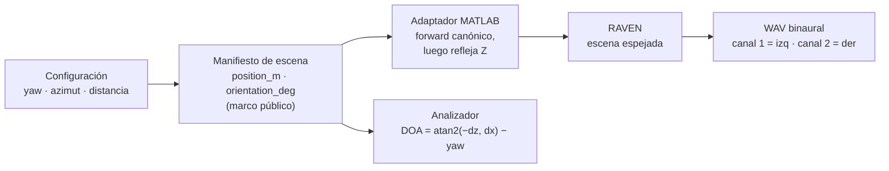

# Contratos e interoperabilidad

[Índice](../README.md) · [Flujo](data-flow.md) · [Auditoría y evidencias](../maintenance/documentation-audit.md)

Esta referencia describe comportamiento observado en productores/validadores, no crea schemas operativos nuevos. Base develop 05f9b27; las diferencias HEAD del analizador están identificadas.

## Versiones por documento

| Artefacto | Productor | Consumidor y restricción |
|---|---|---|
| Experimento YAML | Usuario/configuración | Orchestrator config loader/models/validator; solo modo estático válido |
| Scene y runtime render JSON | `scene_builder.build_static_manifest`, `matlab_runner` | Orchestrator emite 3.0; MATLAB admite 1.0/2.0/3.0 y normaliza ausencia a 1.0 |
| Sidecar render JSON | MATLAB `export_render_metadata` | Versión de escena exportada; flujo actual 3.0 |
| Jobs Clarity JSONL | `clarity_handoff`, constante 1.0 | Backend consume campos/paths; no valida schema_version del job |
| Sidecar degradado JSON | Clarity `SCHEMA_VERSION` 1.0 | Resultado completed/failed; HEAD analyzer admite exactamente 1.0 |
| Índices JSONL | Pipeline/output_index y muestreo | Contratos de sus campos e identidades; no exigirles versión 3.0 de escenas |
| `static_plan.json` y `static_run_summary.json` | Orchestrator, versión entera 1 | Compatibilidad del plan y contabilidad actual separadas de entradas acústicas |
| `failure.json` | MATLAB, versión entera 1 | Evidencia funcional de entrada inválida; Python verifica identidad/hash, no acredita finalización |

El plan versión 1 conserva estados terminales de muestreo en `failed_scenes`, además
del historial de fallos/revisiones. Una escena descartada al agotar T30 no se restaura
como si fuera un hueco accidental. Las realizaciones T30 se publican antes de lanzar
sus intentos y no sustituyen variantes válidas protegidas. En reanudación, las huellas
de cadenas usan los bytes del runtime compatible existente (también CRLF legacy),
no una nueva serialización equivalente. Los runtimes nuevos se escriben con LF.

El analizador develop lee por campos sin validador estricto de versiones. HEAD admite exactamente el string 3.0 para escenas y render, y 1.0 para degradados; registra versiones ausentes/incompatibles como incidencias y conserva observaciones independientes válidas. No asume compatibilidad futura.

## Configuración y ejemplos

El YAML describe un espacio de muestreo, no una escena lista para MATLAB. Rutas relativas se resuelven contra el directorio del YAML. `room_sampling.reverberation` sustituye al antiguo límite `max_rt30_s`; el loader rechaza raíces legacy `outputs.rendered_wav_dir` y `outputs.render_metadata_dir`.

Modelos y validadores son la evidencia de claves, tipos, rangos y relaciones aceptados. Los ejemplos de [configuración](../../configs/experiments/) y [escenas locales](../../apps/matlab/example/) son ilustrativos: algunos conservan contratos legacy o dinámicos y necesitan assets específicos. No modificarlos ni llamarlos normativos por existir.

El pool de fuentes usa WAV (extensión sin distinguir mayúsculas) e ignora sidecars. Pool vacío aborta con su ruta. Con `source_sampling.timing.total_duration_s`, lectura/recorte requieren PCM compatible con Python `wave`, incluso sin offsets; headers inválidos/no soportados no se omiten silenciosamente.

## Plan estático y reanudación no destructiva

`execution.resume_if_possible=true` con `overwrite_existing=false` permite conservar
manifiestos compatibles, completar solo los ausentes y ejecutar variantes sin
salidas. El preflight del lote completo precede a preparar audio, publicar planes
o modificar índices: JSON corrupto/ambiguo, valores no finitos, identidad, geometría,
poses, superficies, referencias o entradas incompatibles producen conflicto con ruta
y motivo. Una salida parcial/no reutilizable preexistente está protegida contra
borrado, movimiento y sustitución. Activar sobrescritura no es una reparación
automática; con ambas opciones activas se siguen prefiriendo resultados válidos.
Con ambas desactivadas, una sustitución necesaria es conflicto explícito.

`{run_root}/metadata/indexes/static_plan.json`, publicado atómicamente con
`schema_version=1`, registra configuración efectiva normalizada, hash del contrato
de generación, identidad/número de escenas, versiones de generador/estimador,
catálogo ordenado y referencias/hashes de entradas seleccionadas. Workers,
reanudación, sobrescritura y reintentos son ajustes operativos excluidos de identidad
acústica; número de escenas, catálogo y entradas funcionales sí afectan al plan.
El registro no sustituye comprobar cada realización ni el validador MATLAB real.

Sin registro de plan se exige replay conservador en memoria de la realización
persistida: índice, semilla entera exacta (sin convertirla a float), intento y
versiones disponibles. La semilla de muestreo no es `render.seed`. Una escena
seleccionada después de T30 se contrasta usando ese intento, no la primera propuesta.
Se compara geometría, fuentes, receptor, selección de ruido/IR y render; se ignora
solo contabilidad mutable. Si no se prueba compatibilidad, se bloquea. La adopción
se publica después del preflight completo y distingue huellas observadas ahora de
huellas originales desconocidas; no reescribe manifiestos ni inventa procedencia.

Una variante reutilizada no crea invocación ni reescribe escena, runtime, audio
preparado, WAV o sidecar: conserva bytes y `mtime_ns`. El runtime esperado se
construye en memoria antes de preparar tareas con efectos. Audio preparado existente
incompatible es conflicto, no sustitución oculta; solo se crean ausentes necesarios
para trabajo nuevo. Se preservan fallos/revisiones del journal de muestreo, rechazos
T30 e IDs estables al completar huecos.

`metadata/indexes/static_run_summary.json` (`schema_version=1`) es la fuente de
contabilidad actual, también en lotes interrumpidos. Separa `generated_scenes`,
`acoustically_accepted_scenes` y variantes completadas; generación no implica
aceptación T30 ni render válido. `reverberation_batch` y otros campos embebidos
históricos son snapshots, no estadísticas que se refresquen reescribiendo escenas
conservadas. Índices/resumen pueden actualizarse fuera de esas entradas protegidas.

Se exige un único orquestador escritor por lote: obtener exclusión y revalidar
precondiciones antes de aplicar acciones. Un lock de estado incierto no se rompe
automáticamente; requiere investigación/intervención, no inferir que el escritor
murió. El paralelismo interno por variantes continúa soportado; el lock no protege
frente a cualquier escritor externo ni garantiza inmutabilidad entre lectura y uso.

## Constancia funcional de render estático

El módulo `pipeline/render_attempt.py` implementa preparación del intento y
verificación de integridad de la constancia versión 1. El runner pasa a MATLAB el
snapshot y el contexto funcional; `pipeline/render_acceptance.py` decide usando
constancia y validación integral independientes. El entrypoint MATLAB admite
emisión mediante su tercer argumento opcional. Estos helpers
no declaran que un WAV sea válido por coincidir su hash.

El layout reserva `{run_root}/metadata/render_attempts/{attempt_id}/`, separado de
`metadata/diagnostics/matlab/`. El helper directo usa `render_attempts/` junto al
manifiesto, o un `attempts_dir` explícito; nunca toma el directorio de diagnósticos.
Cada intento tiene UUID hexadecimal nuevo y conserva:

- `input_manifest.json`: snapshot de los bytes exactos del runtime, escrito sin
  reemplazo en un directorio nuevo; no se reserializa para calcular la huella.
- `outcome.json`: estado funcional del orquestador, publicado mediante temporal y
  reemplazo en el mismo directorio. Empieza `process_status=running`,
  `exit_code=null`, `render_validity=not_verifiable` y `decision=pending`.
- `completion.json`: nombre final reservado para la constancia del productor.
  Un archivo `completion.json.tmp` no constituye finalización.
- `failure.json`: nombre reservado para un informe funcional de entrada inválida,
  independiente de la constancia y de eventos diagnósticos; su ausencia es normal.

El contexto funcional previsto para MATLAB es independiente del argumento de
diagnóstico: `attempt_id`, `variant_id`, `manifest_sha256`, `completion_path` y el
campo aditivo `failure_path`.
El manifiesto invocado será el snapshot; escena y tipo de salida se contrastan con
su contenido. No se añaden claves al YAML ni cambia el schema acústico.

Forma de la constancia (rutas y hashes son ilustrativos, no evidencia real):

```json
{
  "schema_version": 1,
  "attempt_id": "0123456789abcdef0123456789abcdef",
  "scene_id": "scene",
  "variant_id": "scene__binaural_hrtf",
  "output_type": "binaural_hrtf",
  "manifest_sha256": "0000000000000000000000000000000000000000000000000000000000000000",
  "artifacts": [
    {"kind": "wav", "path": "D:/run/out.wav", "size_bytes": 44, "sha256": "0000000000000000000000000000000000000000000000000000000000000000"},
    {"kind": "metadata", "path": "D:/run/out.json", "size_bytes": 2, "sha256": "0000000000000000000000000000000000000000000000000000000000000000"}
  ]
}
```

El lector exige versión entera 1 (no booleano), identidad del intento esperado,
SHA-256 hexadecimal minúscula de 64 caracteres e inventario exacto de salidas
esperadas: `kind`, `path` absoluta, `size_bytes` entero no negativo y `sha256`.
MATLAB puede serializar contadores integrales grandes en notación científica
(`1.411244E+6`). Se normalizan con precisión decimal a enteros solo cuando el valor
es exactamente integral y está dentro del rango seguro de float (`abs <= 2^53`);
no se redondean fracciones ni enteros flotantes inseguros para hacerlos pasar.
Comprueba el snapshot y cada salida por bloques; rechaza duplicados, entradas
faltantes/extrañas, rutas relativas, JSON ambiguo o truncado y cambios de tamaño o
contenido. Las rutas se normalizan según el sistema operativo. Devuelve
`status=missing|invalid|valid` y `issues`; `valid` solo acredita integridad de
archivos, no corrección del audio, metadatos ni T30.

Diagnósticos pueden compartir `attempt_id` mediante argumento opcional, sin ser
la autoridad que lo genera para el contrato funcional. Fallos exclusivos de log,
eventos o resumen diagnóstico no modifican snapshots, constancias ni decisiones.
En cambio, los errores de almacenamiento funcional se propagan. Los hashes no son
firmas contra productores maliciosos ni prueban el contenido de assets externos
que hayan cambiado sin modificar sus rutas en el manifiesto.

### Informe funcional de entrada inválida

MATLAB publica atómicamente `failure.json` solo al fallar carga/validación de entrada,
no ante cualquier error de inicialización, simulación o cierre. El lector Python
exige objeto JSON estricto sin duplicados/valores no finitos, `schema_version` entero
1 (no booleano), `attempt_id` hexadecimal de 32 caracteres, `variant_id` coincidente,
`manifest_sha256` hexadecimal minúsculo de 64 caracteres coincidente con el snapshot,
`category=invalid_input` y `error` con strings `identifier` y `message` (mensaje no
vacío). `scene_id` y `output_type`, si aparecen, también deben coincidir. No se
aceptan campos desconocidos ni se deduce categoría del mensaje de error.

Un informe válido acredita error de entrada y veta reintento de proceso, no éxito
ni finalización. Informe corrupto, ajeno, hash incompatible, constancia coexistente
o resultado de proceso contradictorio bloquea por integridad. Ausencia de informe
no prueba transitoriedad ni etapa alcanzada. Python también puede acreditar entradas
o dependencias ausentes en preflight, sin pretender validar internamente todo MAT/DAFF.

Si falla la publicación, MATLAB conserva y relanza la excepción original; no fabrica
constancia. Llamadas sin contexto o con contexto antiguo mantienen compatibilidad.
`events.jsonl`, consola y diagnóstico de mejor esfuerzo no deciden clasificación,
reintento ni aceptación; sus fallos no reemplazan evidencia funcional. El informe no
confirma la causa de un fallo desconocido como el incidente motivador del cambio.

### Validación independiente de artefactos

`pipeline/render_validation.py` no recibe códigos de salida, consola ni eventos.
Su resultado distingue `valid`, `incomplete` (faltan archivos requeridos), `invalid`
(estructura o valores incompatibles) y `not_verifiable` (no puede leer evidencia).
Los problemas de integridad se separan de `acoustic_rejection` para no tratar
corrupción de archivos como un simple rechazo de muestreo T30.

Perfiles disponibles:

- `normal`: WAV completo y runtime coherente; sidecar según configuración.
- `recovery`: exige sidecar completo incluso si los metadatos son opcionales en el
  YAML. La constancia funcional se verifica aparte y también será obligatoria para
  recuperar un proceso fallido.
- `reuse`: aplica los controles pertinentes de artefactos, sin fabricar proceso.
- Una variante marcada `canonical` exige metadatos y el control acústico T30.

`inspect_variant` ya usa el perfil normal: `completed` exige archivos requeridos y
validación satisfactoria. Archivos presentes pero inválidos son `partial`; sin WAV
ni sidecar producido, el estado es `failed`, aunque exista el runtime de entrada.
Los perfiles de recuperación y aceptación canónica están conectados a la decisión
del pipeline. La continuación con advertencia exige constancia válida y publicación
del outcome y del índice; el proceso conserva estado fallido. El outcome registra
`commit_status=pending|committed|failed`, y una publicación interrumpida no autoriza
continuación. Reanudación y handoff consultan además el historial funcional más
reciente, verifican constancias conservadas y revalidan artefactos contra la entrada
vigente. El handoff repite el control justo antes de enviar al backend.

| Control | Condición de aceptación | Pruebas positivas y negativas |
|---|---|---|
| Runtime | Objeto de schema soportado, escena estática, selección y rutas esperadas, fuentes con identidad/pose/timing válidos | `test_output_index.py`, `test_render_validation.py` |
| WAV | RIFF/WAVE PCM entero soportado de 8/16/24/32 bits, límites de chunks y carga completos, frames alineados y no vacíos | `test_full_pcm_payload_is_valid_for_expected_receiver`, `test_bad_wav_never_passes_for_existence` |
| Canales y frecuencia | Dos canales HRTF/HARTF o N del array, siempre 44100 Hz | Pruebas WAV y `test_array_output_index.py` |
| Dimensiones/duración | Contadores del sidecar iguales al audio; objetivo recortado o rellenado a `max(1, floor(duración * fs + 0.5))` para duración positiva | Pruebas de dimensiones y empate de media muestra |
| Sidecar | JSON de objeto sin campos duplicados ni valores no finitos; schemas string `1.0`, `2.0`, `3.0`; campos obligatorios y redundantes coherentes | Pruebas de estructura, versiones, ausencias y contradicciones |
| Fuentes | Conjunto exacto sin duplicados, procedencia y rutas preparadas, ganancia, inicio, duración/fin coherentes, posiciones y vectores en marco del exportador | Pruebas de fuentes y fixtures emitidas por MATLAB |
| Receptor y semilla | IR seleccionada o descriptor completo del array y orden de canales, marco público de array, política de downmix y semilla normalizada | Pruebas de receptor, seed y array |
| Ruido | Habilitación y capas correspondientes, estrategia normalizada, SNR configurado, seed, duración/canales y aplicación u omisión soportada coherentes | Pruebas de ruido aplicado, omitido y alterado |
| T30 canónico | Diez bandas de octava 31.5–16000 Hz finitas positivas y campos derivados coherentes | Pruebas de T30 válido, rechazado y resumen contradictorio |

Los campos obligatorios del sidecar incluyen `schema_version`, `scene_id`, `job_id`,
`scene_type`, `project_name`, `output_type`, rutas de WAV/sidecar, `sample_rate_hz`,
`summary` con dimensiones, `n_sources` y fuentes. Se acepta un objeto de fuente
única o una lista, como los produce `jsonencode`. No se acepta `{}` ni se interpreta
la ausencia de identidad como coincidencia. Campos legacy de procedencia ausentes
en el manifiesto se comparan como strings vacíos; no se infieren de los nombres.

Los vectores de fuentes se comparan con reflexión Z para schemas 2/3, respetando
la conversión real del backend; roll no modifica esos vectores en la implementación
actual. Las tolerancias de comparación son `abs_tol=1e-6`, `rel_tol=1e-9`. La semilla
prioriza `render.seed`, luego `seed` legacy y, sin ambas, `[]`/`unspecified`.
Omisiones de ruido `silent_signal` o `silent_noise` son resultados soportados, no
fallos automáticos. No se mide SNR físico ni se exige ausencia de silencio/clipping.

Las muestras PCM enteras son finitas por construcción; formatos WAV no soportados,
incluido IEEE-float, no se aceptan silenciosamente. La validación no demuestra
fidelidad física de la convolución o simulación. T30 no incorpora un requisito nuevo
de coincidencia con el bin Sabine. El generador de fixtures MATLAB
`tests/write_render_contract_fixture.m` permite contrastar escritor y lector reales
sin presentar esa prueba de interoperabilidad como un render físico RAVEN.

## Cadenas y reintentos del proceso MATLAB

### Confirmación explícita de una interrupción

`reconcile-static <run_root> --chain <UUID>` inspecciona sin escrituras. Aplicar exige
`--apply --attempt <UUID> --confirm-stopped --reason <motivo>`, exclusión de escritor,
consulta de procesos satisfactoria sin candidatos activos y evidencia de entrada
coherente. No retira locks, no acepta salidas ni modifica el código de salida observado.

El journal versionado `render_attempts/<attempt_id>/interruption_reconciliation/record.json`
enlaza copias exactas anteriores de cadena/outcome, hashes, operador, motivo, fecha e
inventario de salidas. Se publica antes de cambiar outcome y cadena; ambas publicaciones
pueden completarse idempotentemente bajo el lock. Sin concordancia no hay continuación.

La clasificación `confirmed_interruption` requiere verificar ese journal y sus
preimágenes; no basta editar un estado. Conserva `termination_observed=false`,
`exit_code=null` y rechazo funcional. Solo permite programar un nuevo UUID con el ordinal
siguiente de la misma cadena si queda presupuesto. No equivale a recuperación
`post_completion` ni a un proceso fallido observado, y no reinicia el circuito.
El historial anterior sigue vetando reutilización hasta que otro intento sea aceptado.
Los archivos que aparezcan/cambien después de la confirmación no se atribuyen al intento
interrumpido. Evidencia funcional final presente o salidas completas verificables
requieren una revisión distinta, no su sustitución silenciosa.

`execution.matlab_process_retry` admite defaults `max_attempts=3`,
`initial_delay_s=2.0`, `max_delay_s=30.0`, `max_consecutive_failures=5`, también
cuando el YAML anterior omite el bloque. Los presupuestos son enteros positivos
estrictos, no booleanos; esperas finitas no negativas con máximo >= inicial.
`max_attempts` incluye el primer proceso; `1` desactiva repetición. Tras el fallo
ordinal `n`, esperar `min(max_delay_s, initial_delay_s * 2**(n-1))` (2/4 s por defecto).

La aceptación funcional existente se evalúa primero. Recuperación `post_completion`
válida no dispara repetición y conserva proceso fallido/advertencia. Un código no
cero observado sin aceptación ni error determinista acreditado es candidato acotado,
no un fallo transitorio confirmado. No se repiten lanzamiento fallido, terminación
no observada, persistencia fallida, entrada/dependencia inválida acreditada,
constancia/informe contradictorio ni código cero con render inválido. Consola y
eventos no influyen aunque falten. Artefactos íntegros con rechazo T30 siguen la
política acústica: remuestreo distinto de reintento de proceso.

Cada cadena funcional versionada fija variante/realización, runtime/hash, semilla
y política; reserva ordinal duradero antes de lanzar. Cada invocación conserva UUID,
snapshot, constancia y outcome propios, con `chain_id`, ordinal y vínculo previo.
`decision=abort` rechaza ese intento; la programación usa por separado
`retry_decision=scheduled|not_retryable|exhausted|circuit_open`. Un éxito posterior
no convierte el fallo anterior en recuperación ni autoriza usar su evidencia como
propia. Una nueva realización T30 abre otra cadena sin renovar el presupuesto
acústico existente ni entregar artefactos incompletos a Clarity.

Las rutas públicas WAV/sidecar se mantienen. Tras persistir un fallo reintentable
con terminación observada se archivan solo sus propios restos bajo el intento,
con journal de intención/confirmación por archivo: origen, destino, tamaño, SHA-256.
Constancia y snapshot quedan intactos. Se exige archivo confirmado y rutas libres
antes de relanzar; tras interrupción se reconcilian origen/destino y hashes.
Ambigüedad, almacenamiento fallido o salidas protegidas anteriores a la cadena
bloquean, sin borrado ciego. Agotar presupuesto conserva la última evidencia.

La coordinación comparte política entre rutas canónica, secuencial y paralela;
workers ejecutan una invocación y el despacho está acotado a `num_workers`. La racha
cuenta fallos de proceso no recuperados al persistir su resolución; aceptación la
reinicia, T30 sin fallo de proceso no suma ni reinicia. Al umbral el corte se enclava
y persiste: no hay nuevos procesos/reintentos, pero se espera y registra trabajo
en vuelo sin matarlo. Éxito tardío no reabre el lote.

Reiniciar continúa cadenas pendientes identificables con presupuesto y deadline
consumidos. `running` sin terminación observada bloquea hasta intervención; no se
infiere que MATLAB siga vivo ni que haya muerto. Cadenas agotadas/cortadas no se
reabren por restart. Solo una ejecución nueva intencional con
`resume_if_possible=false` y `overwrite_existing=true` abre nuevas cadenas y conserva
las anteriores. Outcomes históricos sin cadena siguen legibles; pueden preceder
una nueva cadena sin salidas protegidas, sin atribuirles política retroactiva.
Rollback operativo: `max_attempts=1`; una versión antigua requiere YAML compatible
y no debe reanudar cadenas pendientes que desconoce. Usar otro run si no puede
verificarlas, nunca borrar evidencia para forzar compatibilidad.

`render_jobs` sigue contando trabajos/variantes intentados, no invocaciones.
`matlab_invocations`, `process_retries`, `variants_completed_after_retry` y razón de
corte amplían el resumen. Ejemplo: una variante aceptada al tercer intento implica
1 trabajo, 3 invocaciones, 2 reintentos, 2 procesos fallidos, 1 variante completada
tras reintento y 0 recuperaciones `post_completion`. Los contadores previos de
procesos fallidos/recuperados incluyen todas las invocaciones reales; recuperación
reanudada es separada. Reutilizar crea cero invocaciones y conserva advertencias.
La excepción terminal mantiene error original y referencias a todos los intentos.
Estos contratos y ejemplos no acreditan una verificación física RAVEN real.

## Geometría, superficies y poses

El productor actual emite `room.geometry.type`, `footprint_vertices_m`, `height_m`, `wall_ids` y trazabilidad `generated_from`. La huella es autoritativa; `shoebox`, `trapezoid` y `l_shape` son prismas de altura constante. El área usa el polígono real y el volumen área × altura. La envolvente rectangular no reemplaza el área de una L o un trapecio.

Schemas 2/3 emplean paredes `wall_###`, floor y ceiling; 3.0 añade superficies acústicas con coeficientes efectivos, tratamientos y `reverberation_sampling`. El legacy 1.0 mantiene shoebox. Los IDs de pared son canónicos, no direcciones cardinales. MATLAB valida y construye el prisma con `setModelToFaces`; no vuelve a muestrear la geometría.

Marco público: `[x,y,z]` en metros, Y vertical, huella `[x,z]`. Scene y runtime JSON conservan poses públicas. MATLAB `transform_schema2_pose_to_raven` refleja Z en posición, view_vector y up_vector para schemas 2/3. `summary.sources` se exporta desde fuentes adaptadas RAVEN; no mezclar esas coordenadas directamente con las de la escena.

HEAD analyzer prioriza poses del manifiesto; el fallback documentado desde sidecar RAVEN + ITA refleja Z de vuelta al marco público y declara procedencia. Si no se establece marco/orientación, excluye los cálculos espaciales afectados; yaw ausente no es cero. develop carece de esta conversión ampliada.

## Convención de orientación y lectura de metadatos

Capability `spatial-pose-convention`. Todos los componentes convierten ángulos en direcciones, y
direcciones en ángulos, con la misma fórmula en el marco público `(x, y, z)` (metros, +Y vertical):

```text
forward(yaw, pitch) = (cos p·cos y,  sin p,  −cos p·sin y)
```

Yaw 0 y pitch 0 apuntan a +X; el yaw positivo gira de +X hacia −Z; el pitch positivo inclina hacia
+Y; roll no cambia la dirección. El adaptador MATLAB (esquemas 2.0/3.0) calcula esta dirección y
luego refleja Z, `[x, y, −z]`, igual que las posiciones. Esa reflexión espeja la escena completa
(sala, materiales y poses), así que la acústica es coherente, pero **izquierda y derecha se leen
espejadas respecto de una lectura dextrógira del marco público**. La prueba de aceptación con RAVEN
(receptor con yaw +90, fuente a 0.7 m) lo confirma: con azimut +90 el ILD (izquierdo − derecho) fue
−6.0 dB, y con azimut −90 fue +2.1 dB.

Regla práctica: **ángulo positivo = hacia la derecha del oyente**, tanto para yaw como para azimut,
canales del array y DOA del analizador. El WAV binaural guarda el oído izquierdo en el canal 1 y el
derecho en el canal 2, el mismo orden que asume MSBG.

### Vista del oyente

Los diagramas siguientes dibujan el plano horizontal visto como lo escucha el oyente: el frente
hacia arriba de la página y su oído derecho hacia la derecha.

```text
Azimut relativo al yaw del receptor

                         0°  (frente)
                             ▲
              −45°           │           +45°
                   ╲         │         ╱
                    ╲        │        ╱
   −90°  oído izq.  ◄─────── ○ ───────►  oído der.  +90°
         (canal 1)           │           (canal 2)
                             │
                        ±180° (atrás)
```

```text
Ejes públicos con yaw 0                 Mismo receptor con yaw +90

               +X  (frente)                           −Z  (frente)
                ▲                                      ▲
                │                                      │
   +Z  ◄─────── ○ ───────►  −Z           +X  ◄──────── ○ ────────►  −X
  (izquierda)        (derecha)          (izquierda)          (derecha)

                                        yaw +90 = girar 90° a la derecha
```

### De la configuración al manifiesto

`fixed_position` no guarda el azimut en el manifiesto: lo convierte en posición. La fuente queda en
`receiver.position_m + distancia · forward(yaw + azimut, pitch + elevación)`. Ejemplo real de la
prueba de aceptación (`scene_speech_fixed_0001`):

```text
configuración                    cálculo                           manifiesto de escena
─────────────                    ───────                           ────────────────────
spatial_policy:                  ángulo = yaw + azimut             receiver.position_m
  azimuths_deg:   [90]   ──►            = 90 + 90 = 180°    ──►      [1.414, 1.000, 1.416]
  elevations_deg: [0]            forward(180°, 0°) = [−1, 0, 0]    receiver.orientation_deg.yaw
  distances_m:    [0.7]          fuente = receptor + 0.7·[−1,0,0]    90
receiver yaw: 90                                                   sources[0].position_m
                                                                     [0.714, 1.000, 1.416]

audio renderizado: la fuente se oye a la DERECHA (ILD izq − der = −6.0 dB)
```

### Del manifiesto al ángulo (analizador)

El analizador recupera el ángulo desde las posiciones del manifiesto, sin leer la configuración:

```text
d = source.position_m − receiver.position_m = (dx, dy, dz)

DOA global   = atan2(−dz, dx)                  0° = +X, positivo hacia −Z
DOA relativo = DOA global − receiver yaw       envuelto a [−180°, 180°)
elevación    = atan2(dy, hypot(dx, dz))

ejemplo: d = (−0.7, 0, 0)  →  global = atan2(−0, −0.7) = −180°  (envuelto)
                              relativo = −180° − 90° = −270° ≡ +90°   (derecha; coincide con el azimut)
```

### Array circular

El micrófono `k` está en `center_m + radius_m · [cos θk, 0, −sin θk]`, con `θk = yaw + 360·k/N`.
El micrófono 0 apunta al frente y el índice avanza hacia la derecha. `channel_index = k + 1`.

```text
Array de 4 micrófonos con yaw 0 (frente = +X)

                    mic 0 · canal 1   (+X, frente)
                            ●
                            │
  mic 3 · canal 4  ●─────── ○ ───────●  mic 1 · canal 2
  (+Z, izquierda)        center_m        (−Z, derecha)
                            │
                            ●
                    mic 2 · canal 3   (−X, atrás)
```

### Recorrido de las coordenadas



### Lectura rápida

| Dato | Dónde aparece | Cómo leerlo |
|---|---|---|
| `orientation_deg.yaw` | manifiesto (receptor, fuentes) | 0 = +X; positivo = girar a la derecha (hacia −Z) |
| `orientation_deg.pitch` | manifiesto | positivo = hacia arriba (+Y) |
| `orientation_deg.roll` | manifiesto | no cambia la dirección |
| `spatial_policy.azimuths_deg` | configuración | relativo al yaw; 0 frente, + derecha, − izquierda, ±180 atrás |
| `spatial_policy.elevations_deg` | configuración | positivo = hacia arriba |
| `microphones[k]` del array | manifiesto | k = 0 al frente; el índice crece hacia la derecha; canal WAV = k + 1 |
| DOA relativo | reporte del analizador | mismo sentido que el azimut |
| canales del WAV binaural | audio | 1 = oído izquierdo, 2 = oído derecho |
| `summary.sources` | sidecar RAVEN | coordenadas RAVEN (Z reflejada), no públicas |

Los manifiestos sin esquema 2.0/3.0 conservan su camino heredado en MATLAB. Las salidas generadas
antes de esta convención (renders con yaw distinto de cero, `fixed_position`,
`facing_surface_normal` o arrays) son inconsistentes y deben regenerarse en un directorio de salida
nuevo, porque la reanudación no distingue la convención con que se generaron. Con yaw 0 los renders
binaurales anteriores ya tenían este mismo sentido de izquierda y derecha; lo que cambia es el DOA
del analizador y el orden del array.

## Reverberación y tratamientos

El sampler estratifica el RT30 estimado mediante bins de igual ancho, cuotas balanceadas y tratamientos virtuales versionados en paredes/cielo, conservando scattering; el piso no recibe tratamiento. Usa el presupuesto compartido de intentos de escena y puede seleccionar un fallback válido en rango. Las cuotas son diagnósticas, no garantía de uniformidad exacta ni de uniformidad del T30 posterior de RAVEN.

La estimación Sabine conserva diez bandas de octava, pero su media/clasificación usa 125, 250, 500, 1000, 2000, 4000 y 8000 Hz. RAVEN informa diez bandas 31.5–16000 Hz; `mean_t30_s` requiere diez valores finitos positivos o queda vacío/unavailable. Estas medias no son directamente comparables y no provienen de mediciones del WAV.

HEAD analyzer alinea frecuencias explícitas y consolida variantes por escena/banda con tolerancia `abs(a-b) <= max(1e-6 s, 1e-6 * max(abs(a), abs(b)))` sobre todas las parejas válidas. Un conflicto excluye solo la banda RAVEN afectada y su par; Sabine y otras bandas permanecen disponibles. Es equivalencia numérica fija, no precisión certificada del simulador. Los promedios comparables reutilizan el mismo conjunto de pares válidos, sin interpolar ni ponderar una sala por HRTF.

## Backend de render seleccionable

`render.backend` admite `raven` (por defecto) y `pyroomacoustics`. La tabla declarativa
`pipeline/render_backends.py` fija por backend las frecuencias admitidas (`{44100}` en ambos),
el descriptor T30 esperado y la identidad exigida en el sidecar; la validación de configuración,
de render y del índice la consultan en lugar de literales.

**Identidad del plan.** `normalized_static_config` omite `render.backend: raven` y un bloque
`pyroomacoustics` nulo, por lo que las configuraciones existentes conservan su identidad
normalizada. Este cambio sí modifica archivos incluidos en el contrato del generador
(`config/validator.py`, `experiment/scene_builder.py`): un run RAVEN planificado antes informa el
conflicto explícito "Generation contract changed" al reanudar, sin reescribir ni borrar
artefactos. Termine esos runs o use otro `run_name`.

**Manifiestos.** Con `raven` los manifiestos de escena y de ejecución no cambian (sin
`render.backend`). Con `pyroomacoustics` incluyen `render.backend: pyroomacoustics`,
`render.backend_parameters` (`max_order`, `max_order_non_shoebox`, `air_absorption`,
`temperature_c`, `humidity_pct`, valores efectivos) y `base_rpf_file: null`; el plan no
fingerprinta un RPF. Como la reanudación compara el manifiesto de ejecución completo, un cambio de
backend o de parámetros nunca reutiliza una variante.

**Proceso.** El despacho único (`_run_single_render_task`) usa `render.backend` del snapshot.
El worker `python -m acoustic_orchestrator.backends.pyroomacoustics.worker <snapshot>
--attempt-id --variant-id --manifest-sha256 --completion-path --failure-path [--events-path]`
lee solo el snapshot, publica `failure.json` (`invalid_input`) ante errores de carga/validación,
escribe WAV, sidecar y constancia (mismo formato schema 1, `.tmp` + `os.replace` sin reemplazar
una existente) y emite los eventos `initialization`, `simulation` (pasos `pyroomacoustics_rir` y
`audio_postprocessing`), `artifact_writing`, `artifact_written` y `entrypoint_completed`. Sale 0
solo tras publicar. El proceso hijo recibe `OMP_NUM_THREADS=1` y `PRA_NUM_THREADS=1`.
`reconcile-static` reconoce el worker como proceso de render activo.

**Sidecar Pyroomacoustics.** Contiene todos los campos que exige la validación de variantes array
(poses legacy con Z reflejada en `summary.sources`, `receiver.circular_array`,
`coordinate_frame: public_xyz_y_up`, semillas, ruido, `batch`) más
`summary.render_backend: Pyroomacoustics` y un bloque `backend`: `name`, `version`,
`simulation` (`method: ism`, órdenes, `effective_max_order`, `air_absorption`, temperatura,
humedad, `speed_of_sound_m_s`, `ray_tracing: false`, `randomized_image_sources: false`,
`seed_applied`), `coordinate_transform`, `room`, `positions_m` (marco backend), `materials`
(octavas convertidas con `scattering_applied: false`), `rir` (`global_delay_samples`,
`frac_delay_length`, `high_pass_filter`, `lengths_samples`) y `t30_pairs_s`
(`[fuente][micrófono][banda]`). La validación rechaza una variante no RAVEN cuya identidad no
coincide (`render_metadata_backend_identity_mismatch`); un sidecar RAVEN solo se rechaza si
declara otro backend.

**T30.** RAVEN: `method: rpf.getT30`, `estimated_from: room`. Pyroomacoustics:
`method: schroeder_backward_integration_v1`, `estimated_from: rir`: filtro de octava
Butterworth (orden 3 por lado) aplicado hacia atrás, borde superior a 0.95·Nyquist, integración
de Schroeder, ajuste entre −5 y −35 dB extrapolado a 60 dB; una banda es nula si la envolvente no
decae 35 dB antes del final de la RIR; la banda informada es la media sobre pares y es nula si
algún par lo es. Un método ajeno al backend de la variante se rechaza. La puerta canónica y su
remuestreo no cambian. Un orden ISM insuficiente acorta la RIR y sesga el T30 a la baja.

**Transformación de coordenadas.** Marco backend Z-arriba: rotación `R = [[1,0,0],[0,0,-1],[0,1,0]]`
(`(x, −z, y)`, det +1) seguida de la traslación por sala `t = (−min x, max z, 0)` que ancla la
huella en el origen (la primitiva rectangular de Pyroomacoustics solo admite `[0, dims]`). Es una
transformación rígida sin componente vertical; se registra en `backend.coordinate_transform`.
Las coordenadas backend solo aparecen bajo `backend.*`. Los materiales usan el mapeo de frecuencia
central del estimador Sabine; Pyroomacoustics 0.10.1 opera con bandas de 125 a 16000 Hz, de modo que
los coeficientes de 31.5 y 63 Hz no tienen efecto propio. No se declara equivalencia acústica con
RAVEN.

**Convención de orientación.** Pyroomacoustics recibe las posiciones del array ya calculadas con la
convención común; ver
[Convención de orientación y lectura de metadatos](#convención-de-orientación-y-lectura-de-metadatos).

## Clarity y errores

`expected_output_wav_path` y `expected_output_metadata_path` son autoritativos. Paths relativos de jobs se resuelven respecto del directorio de trabajo del proceso, no del JSONL. `backend_invocation` sirve al orquestador; no se copia al resultado por el backend. El WAV degradado conserva basename y su sidecar el stem.

El catálogo valida perfiles únicos, dos oídos y pérdidas finitas. MSBG exige exactamente 250, 500, 1000, 2000, 4000 y 8000 Hz por oído, WAV estéreo 44100 Hz; bandas extras o ausentes fallan. El procesamiento preserva longitud, sample rate y subtipo original.

Errores de procesamiento/perfil capturados escriben metadata failed y permiten continuar; un lote con fallos sale 1. JSONL malformado, campos estructurales ausentes o problemas al preparar/escribir paths pueden abortar fuera de esa recuperación. No prometer tolerancia universal.

HEAD analyzer distingue incidencias de metadatos de fallos operativos: metadatos incompletos pueden dar reporte parcial o sin observaciones, mientras OSError de raíz/escritura produce error de CLI. Su reporte no verifica audio ni SNR medido, clipping, LUFS o calidad acústica. Las exportaciones conservan denominadores y procedencia; la [guía local](../../apps/output-analyzer/README.md) lista poblaciones y formatos.
