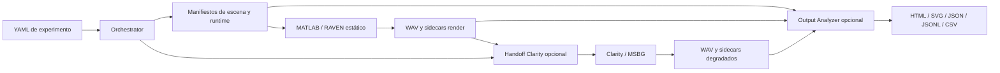

# Arquitectura actual

[Índice](../README.md) · [Flujo](data-flow.md) · [Contratos](contracts.md)

Referencia: `develop@05f9b27`, con diferencias explícitas del analizador en `update-fix-output-analyzer@1a3b1c1`. [Comparación y evidencias](../maintenance/documentation-audit.md).

## Cuatro aplicaciones, generación y análisis

| Aplicación | Responsabilidad | Interfaz pública y dependencias |
|---|---|---|
| Orchestrator | Cargar y validar YAML, muestrear escenas, preparar runtime, coordinar render y Clarity, mantener índices | `acoustic-orchestrator`; Python, Pydantic, PyYAML, Typer, Rich; invoca procesos |
| MATLAB | Construir geometría, receptor/fuentes y RAVEN; render estático y metadatos | `run_raven_static_render`; MATLAB, ITA Toolbox, RAVEN y assets locales |
| Clarity Backend | Degradar WAV según perfil auditivo y paths explícitos de cada job | `clarity-backend run-manifest`; Python, pyclarity/MSBG, NumPy, SciPy, soundfile, PyYAML |
| Output Analyzer | Interpretar metadatos de un run y generar reporte/exportaciones | `output-analyzer analyze`; Python, sin dependencias runtime externas declaradas |

El pipeline de generación tiene orquestación, render y degradación opcional. El analizador es una aplicación posterior independiente: no constituye una cuarta etapa obligatoria ni necesita audio para inspeccionar metadatos. Está presente tanto en develop como en HEAD. Las tres aplicaciones Python pertenecen al workspace uv; MATLAB no es un paquete uv.

La flecha de render a analizador representa lectura de sidecars, no del WAV. Intercambio entre aplicaciones mediante archivos y subprocesos: el orquestador no importa los internals de Clarity.

## Comportamiento soportado

El flujo soportado es estático. El modelo de configuración contiene `dynamic`, pero el validador lo rechaza. `run_raven_dynamic_render.m` existe y `dynamic/render_dynamic_scene.m` sigue como placeholder. No describirlo como render funcional.

El orquestador genera escenas `shoebox`, `trapezoid` y `l_shape`, aplica políticas de posición —incluida `fixed_position`— y muestrea reverberación estimada mediante bins y tratamientos virtuales versionados. Los vertices y superficies materializados evitan reconstruir la parametrización YAML en MATLAB. Las cuotas son diagnósticas y no garantizan uniformidad del T30 que RAVEN informa después.

MATLAB renderiza variantes de receptor/HRTF, mezcla fuentes, aplica temporización/ganancias, recorte opcional y ruido configurado, y exporta WAV y sidecars. Su flujo estático exige 44100 Hz. Clarity recibe trabajos elegibles por variante/perfil y escribe degradaciones en paths reservados.

## Analizador y procedencia de revisión

En develop, el analizador tiene lectura inicial por campos, registros por sidecar, gráficos y exportaciones básicas; su HTML requiere la carpeta `images`. No valida estrictamente versiones ni implementa las poblaciones únicas y RT30 ampliado de HEAD.

En HEAD, el analizador valida escenas/render exactamente 3.0 y degradados 1.0, trata incidencias de metadatos, distingue escenas/fuentes únicas de variantes, usa geometría poligonal, consolida RT30 por frecuencia y produce HTML autónomo con carruseles manuales. La [guía local](../../apps/output-analyzer/README.md) describe estas capacidades verificadas de HEAD. No inferir que están incluidas en el commit local de develop.

## Fronteras y límites

Las rutas y versiones se describen una sola vez en [contratos](contracts.md); las opciones de CLI y desarrollo específico permanecen en las [guías locales](../README.md#guías-locales). El código, validadores y tests son evidencia principal; ejemplos y PRD no introducen contratos alternativos.

MATLAB/RAVEN/ITA y los assets requieren entorno local. `prepare_raven_project` conserva una ruta Windows específica. La semilla se aplica al RNG de MATLAB, con `raven_seed_applied=false`; no se certifica identidad bit a bit de BRIR o T30. Esta auditoría no ejecutó render ni DSP.
